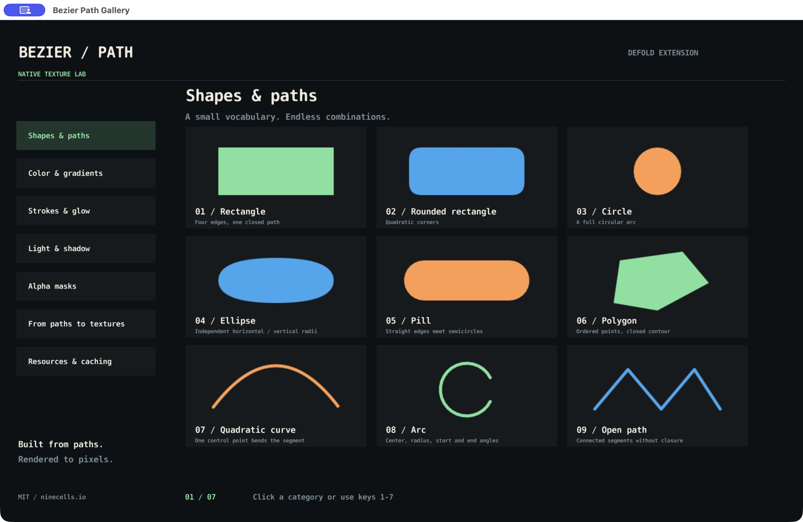
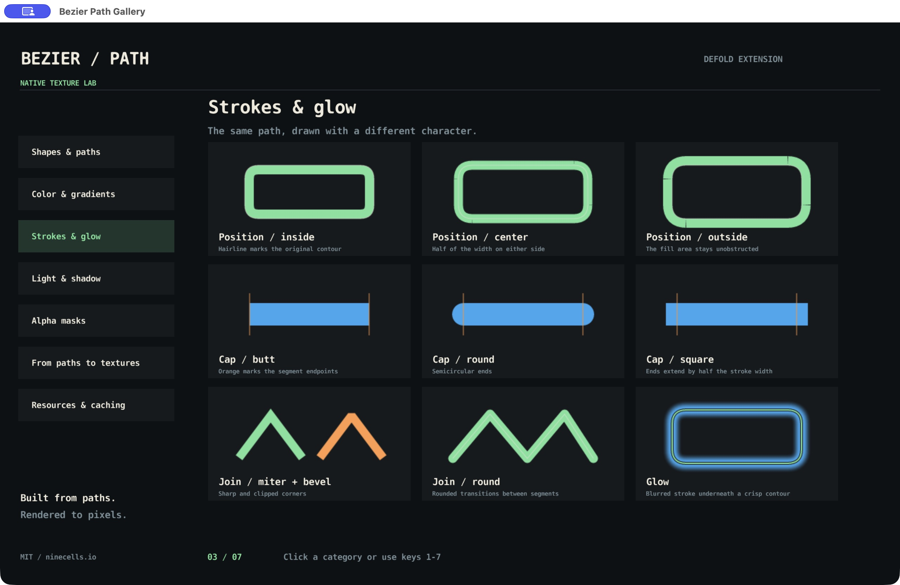
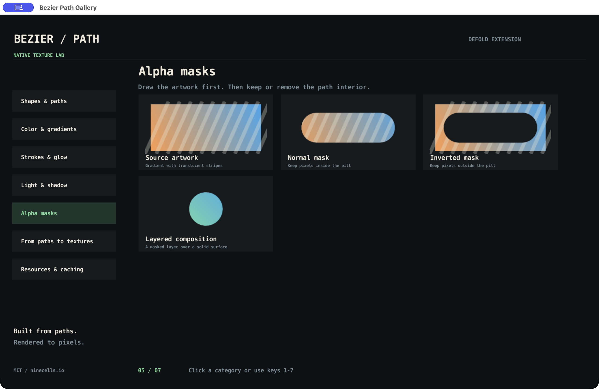
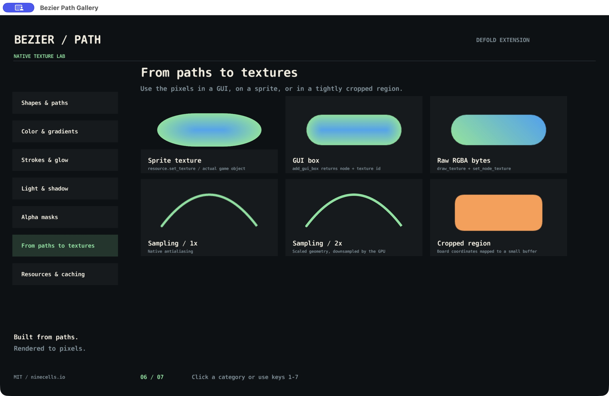

# Bezier Path

Draw antialiased paths into textures in [Defold](https://defold.com/): rounded shapes, quadratic curves, arcs, gradients, strokes, shadows, glow, and alpha masks. Use the resulting pixels in GUI nodes or sprite textures. Rendering is CPU-based C++ with a Lua convenience API.

## Gallery

Open `game.project` in Defold, fetch libraries, and choose **Project → Build**. Click the category buttons or press **1–7** to explore shapes, fills, strokes, shadows, masks, texture integration, and resource lifecycle. The 1280 × 800 interface fits the window while preserving its proportions.






Each drawing example lives in [gallery_features.lua](example/gallery_features.lua); navigation and presentation are separate modules. The lifecycle page has explicit enable, rebuild, and clear controls for its optional disk cache. Other pages leave disk caching disabled. Switching pages releases the previous page's textures and GUI nodes.

## Installation

Add both libraries to **game.project → Project → Dependencies**, then fetch libraries:

```ini
[project]
dependencies#0 = https://github.com/ninecells-io/defold-bezier-path/archive/refs/tags/1.0.0.zip
dependencies#1 = https://github.com/ninecells-io/defold-helpers/archive/refs/tags/0.1.6.zip
```

The first URL pins this library to release 1.0.0 for reproducible builds. See the [release notes](https://github.com/ninecells-io/defold-bezier-path/releases/tag/1.0.0). `defold-helpers` 0.1.6 is a public dependency used for color and GUI node helpers; consumers must add it explicitly because Defold does not fetch transitive library dependencies. Only `bezierpath/` is exported as this library.

A native extension build is required. Defold's normal hosted build service is supported; the extension has no OS-specific rendering dependencies. The current demo is validated with Defold 1.13.0 on Apple Silicon macOS; other platforms require their own build/runtime verification.

## Quick start: a GUI texture

Attach this code to a GUI script, give the scene at least one dynamic texture slot, and use the default GUI material:

```lua
local bp = require "bezierpath.bezierpath"

function init(self)
    local node = gui.new_box_node(vmath.vector3(200, 160, 0), vmath.vector3(240, 96, 0))
    gui.set_size_mode(node, gui.SIZE_MODE_MANUAL)
    self.texture = bp.create_texture("example:green-button:v1", 240, 96, function(b, factor)
        bp.with_path(b, function(h)
            -- create_texture scales the buffer; scale your geometry too.
            bp.rounded_rect(h, 8*factor, 8*factor, 224*factor, 80*factor, 20*factor)
            bp.fill_path(b, {r=143, g=232, b=167, a=1})
        end)
    end)
    gui.set_texture(node, self.texture)
end

function final(self)
    if self.texture then gui.delete_texture(self.texture) end
end
```

Color tables use `{r, g, b, a}` **named fields**: RGB channels are `0–255`, alpha is `0–1`. Defold GUI colors use normalized `vmath.vector4` values instead. Do not interchange the two formats.

## Coordinates, buffers, and ownership

- Coordinates are texture pixels, with `(0, 0)` at the bottom-left when uploaded to a GUI texture. The shape helper parameter named `top` is simply the starting y coordinate. Circle/ellipse arguments are radii, so their dimensions are twice those values.
- Arc angles are **radians**, relative to the positive x axis; `clockwise=true` decreases angles. Linear gradient angles are **degrees**.
- Shape helpers replace the current path. Incremental `add_*` methods append to it. Filling and stroking use `buffer_info.path_handle`; set it when changing which path a buffer should draw.
- Paths have stable numeric handles. `create_path(b)` assigns the new handle to `b.path_handle`; `with_path(b, fn)` guarantees deletion even when `fn` raises an error. Neither deletion nor scoped cleanup restores the buffer's previous handle. Select a live handle before drawing again.
- Dynamic GUI textures belong to their GUI scene. Keep the returned texture id if you delete textures explicitly. Deleting a GUI node does **not** delete its texture. Nodes sharing a texture must release it only after all users are finished. Scene destruction also releases textures.
- The renderer uses premultiplied RGBA for high-level texture helpers, matching Defold's default GUI/sprite blending. Raw buffers can choose `premultiply_alpha=false`. `init_buffer` clears pixels before writing a background color; `fill_color` replaces the complete buffer.
- Rasterization and uploads can be expensive, especially large shape gradients, blurs, or high supersampling factors. Generate static textures once and reuse them; this is not a per-frame vector renderer.

A low-level buffer has this shape:

```lua
local b = {
    buffer = buffer.create(width * height, {
        {name=hash("rgba"), type=buffer.VALUE_TYPE_UINT8, count=4}
    }),
    width=width, height=height, channels=4,
    premultiply_alpha=true, path_handle=0,
    origin_x=0, origin_y=0,
}
```

Use positive integer dimensions and a matching byte buffer. Dimensions and channels must be numeric values; fractional, nonfinite, and out-of-range values are rejected. Channels must be 3 or 4, the backing buffer must contain at least `width * height * channels` bytes, and that product must fit a signed 32-bit byte offset. RGB (`channels=3`) is supported for low-level color rendering; alpha masks require RGBA. The optional origin maps cropped pixels into the coordinate system of the original path. The raw Defold buffer remains owned by Lua; GUI textures contain uploaded pixel data.

## Lua wrapper API

Use `local bp = require "bezierpath.bezierpath"`. Unless a return value is listed, drawing and path-mutating functions return nothing. `b` below means `buffer_info`, `h` means a path handle, and `color` means a named-field color table.

### Points and paths

| Function | Behavior / return |
| --- | --- |
| `point(x, y)` | `{x=x or 0, y=y or 0}`. |
| `zero()` | `{x=0, y=0}`. |
| `quad_curve_point(point, control_point)` | Polygon descriptor `{x,y,cx,cy}`. |
| `arc_point(center, radius, start_angle, end_angle, clockwise)` | Circular-arc polygon descriptor; angles in radians. |
| `create_path(b)` | New numeric handle; optional `b` receives `path_handle`. |
| `delete_path(h)` | Release one path; does not invalidate other handles. |
| `with_path(b, fn)` | Call `fn(h)`, release `h` on success or error, and return all callback results. `b` may be nil. |
| `clear_all_paths()` | Release all paths. Only use when no code retains a handle; handles may be reused afterward. |
| `reset_path(h)` | Clear points and mark open. |
| `get_path_bounds(h, padding)` | `{x,y,width,height}`, or nil for an empty path; padding defaults to 0. Includes flattened curves, not automatic stroke/shadow expansion. |
| `add_point(h, point)` | Append a straight endpoint. |
| `add_quad_curve_point(h, point, control_point)` | Append a quadratic segment. |
| `add_arc(h, center, radius, start_angle, end_angle, clockwise)` | Append a circular arc. |
| `set_path_closed(h, closed)` | Set closure explicitly. |
| `polygon(h, points, closed)` | Replace points in array order; accepts point, quadratic, and arc descriptors. `closed` defaults to false. |
| `line(h, point1, point2)` | Replace with a two-point open path. |
| `rounded_rect(h, left, top, width, height, edge_radius)` | Replace with a closed rounded rectangle; radius 0 gives square corners. |
| `circle(h, left, top, radius_x, radius_y)` | Replace with a closed circle or ellipse; pass both radii. |
| `pill(h, left, top, width, height)` | Replace with a horizontal or vertical pill; nonpositive dimensions produce an empty open path. |

### Pixel operations

| Function | Behavior |
| --- | --- |
| `init_buffer(b, color)` | Clear the buffer, then write `color`; color is required by the wrapper. |
| `fill_color(b, color)` | Replace every pixel with the given color; alpha 0 is a no-op. Use `init_buffer` to clear. |
| `fill_path(b, color)` | Fill the current path. |
| `fill_path_gradient(b, color1, color2, angle)` | Linear gradient, angle in degrees. |
| `fill_path_gradient_shape(b, color1, color2)` | Gradient based on distance from the contour toward the interior. |
| `mask_path(b, inverted)` | Clear inside the path; `inverted=true` clears outside instead. Operates on existing pixels. |
| `fill_shadow(b, offset, radius, inner, color)` | `offset` is a point; `inner=true` clips to the interior. Include blur/offset padding to avoid clipping. |
| `stroke_path(b, width, color, position, cap_style, join_style)` | Positions: `center` (default), `inside`, `outside` (one-sided offsets follow path winding); caps: `butt` (default), `round`, `square`; joins: `miter` (default, limit 4 with bevel fallback), `round`, `bevel`. |
| `stroke_path_glow(b, width, radius, position, color)` | Blurred stroke; position defaults to `center`. |

### Texture generation and GUI integration

| Function | Behavior / return |
| --- | --- |
| `draw_texture(width, height, draw_fn, factor, params)` | Allocate a transparent RGBA buffer, call `draw_fn(b, factor, params)`, return RGBA byte string. Dimensions are physical pixels; `factor` is passed through, not applied to dimensions. No cache. |
| `create_texture(key, width, height, draw_fn, params, factor)` | Return opaque GUI texture id. Physical dimensions are `floor(width*factor)` × `floor(height*factor)`; callback is `draw_fn(b, factor, params)`. Default factor is 2. Scale geometry explicitly. |
| `add_gui_box(root, width, height, pos, visible, key, draw_fn, params)` | Create a manual-size GUI box and return `node, texture_id`. Uses factor 1 and calls `draw_fn(b, params)`. Parent and position may be nil; omitted visibility means visible. |
| `new_texture(width, height, key, bytes, texture_size)` | Upload existing RGBA bytes; return opaque texture id, or nil for nil bytes. Optional `texture_size={width,height}` overrides upload dimensions. |
| `set_node_texture(node, width, height, key, bytes, texture_size)` | Upload/assign existing bytes and return texture id; nil bytes leave the node unchanged. |
| `draw_texture_region(bounds, draw_fn, params)` | Return `bytes, normalized_bounds`; callback is `draw_fn(b, params)`. Factor 1 with original-coordinate origin, no cache. |
| `create_texture_region(key, bounds, draw_fn, params)` | Return `texture_id, normalized_bounds`; same origin/callback behavior as the raw region helper, with optional caching. |
| `set_default_texture_factor(factor)` | Set and return default supersampling factor; values below 2 clamp to 2, invalid/nonfinite values reset to 2. |
| `get_default_texture_factor()` | Return the current default factor. |
| `begin_texture_generation(owner)` | Delete the previous generation's tracked textures for this owner and start tracking newly requested textures. Owner must be non-nil; generations cannot nest. |
| `end_texture_generation(owner)` | End tracking; owner must match the active generation. |
| `configure_texture_cache(options)` | Configure optional disk caching; see below. |
| `clear_texture_cache()` | Invalidate tracked disk files; returns whether invalidation succeeded. Already-live GUI textures remain until deleted. |

Regions floor x/y, ceil their right/top edges, and have dimensions of at least one pixel. Use `get_path_bounds` plus explicit stroke/shadow padding when calculating a crop.

Texture keys must encode **every input that changes the pixels**. They are logical keys, not GUI texture names: keep the opaque returned id for `gui.set_texture` and `gui.delete_texture`. Same-scene texture reuse skips the callback even when disk caching is disabled. The callback must therefore only draw pixels, without required external side effects.

Generation tracking is intended for one exclusive owner of a texture set. Delete or detach old nodes before starting the next generation. Do not share generation-owned textures across independent owners: the next generation deletes the previous textures immediately.

For density-aware textures, an application can set `bp.set_default_texture_factor(math.max(2, window.get_display_scale() * interface_scale))`. An explicit positive factor passed to `create_texture` overrides the default, including factor 1.

### Optional persistent cache

```lua
bp.configure_texture_cache({
    enabled = true,
    folder = "my-game-bezier-textures",
    version = "art-v1",
    max_size_bytes = 256 * 1024 * 1024,
})
```

Caching is disabled by default. `folder` is the application-specific namespace passed to `sys.get_save_file()`. Change `version` when rendering logic or unencoded inputs change. Reconfiguration with a different version clears files tracked by the previous manifest.

Cache identity includes the logical key, version, texture kind, physical dimensions, and factor. Only high-level GUI texture helpers use disk caching; raw buffer functions do not. Hits skip drawing. Missing, corrupt, truncated, or unwritable files fall back to normal rendering.

The default budget is 256 MiB on iOS/Android and 512 MiB elsewhere. Zero disables disk storage. Least recently used tracked files are evicted before writes; oversized textures remain uncached. Reducing the limit trims existing files. Failed evictions suppress new writes until enough space is available. Headers count toward the budget; the manifest does not. Older cache formats are invalidated automatically.

## Native API

The native extension registers the global `bezierpath`; the recommended wrapper above uses it internally. Native colors are separate numeric arguments, and native point methods accept numeric coordinates. Native `create_path()` takes no buffer argument, and native `init_buffer(b)` only clears pixels.

| Native function | Behavior |
| --- | --- |
| `fill_color(buffer_info, red, green, blue, alpha)` | Replace every pixel with the given color; alpha 0 is a no-op. Use `init_buffer` to clear. |
| `create_path()` | Return a new native path handle. |
| `delete_path(handle)` | Release a path handle. |
| `get_path_bounds(handle, padding)` | Return {x,y,width,height}, or nil for an empty path; padding defaults to zero. |
| `clear_all_paths()` | Release all native paths; only call when no owner retains handles. |
| `reset_path(handle)` | Clear points and mark the path open. |
| `add_point(handle, x, y)` | Append a straight segment endpoint. |
| `add_quad_curve_point(handle, x, y, cx, cy)` | Append a quadratic endpoint and control point. |
| `add_arc_point(handle, center_x, center_y, radius, start_angle, end_angle, clockwise)` | Append a circular arc; angles are radians and clockwise decreases angles. |
| `set_path_closed(handle, closed)` | Set whether the contour is closed. |
| `init_buffer(buffer_info)` | Zero the complete buffer. |
| `fill_path(buffer_info, red, green, blue, alpha)` | Fill the selected path. |
| `fill_path_gradient(buffer_info, red1, green1, blue1, alpha1, red2, green2, blue2, alpha2, angle)` | Fill a linear gradient; angle is in degrees. |
| `fill_path_gradient_shape(buffer_info, red1, green1, blue1, alpha1, red2, green2, blue2, alpha2)` | Fill a gradient from the contour toward the interior. |
| `fill_shadow(buffer_info, offset_x, offset_y, radius, inner, red, green, blue, alpha)` | Composite an inner or outer blurred shadow. |
| `mask_path(buffer_info, inverted)` | Clear alpha inside the path; inverted=true clears the exterior. |
| `stroke_path(buffer_info, width, red, green, blue, alpha, position, cap_style, join_style)` | Stroke a path; defaults are center, butt, miter. |
| `stroke_path_glow(buffer_info, width, radius, position, red, green, blue, alpha)` | Draw a blurred stroke; position defaults to center. |
Native color channels are clamped to their documented ranges. Supply valid handles and appropriately sized buffers; do not rely on invalid inputs being accepted. Editor declarations in `bezierpath/api/bezierpath.script_api` and `idea_autocomplete.lua` describe this native global API.

## Development and tests

For the normal workflow, use the Defold editor. Command-line builds require Java 25 and the pinned Bob builder (downloaded automatically):

```sh
make setup-bob
make build                        # resolves public dependencies and builds this demo
make bundle                       # creates a runnable debug bundle
make build PLATFORM=x86_64-linux   # choose another Defold target
```

`JAVA_BIN` selects the Java executable. The builder is pinned to Defold 1.13.0 in `scripts/config.sh`. No private token, sibling checkout, or custom dependency server is required. Build outputs are ignored by Git.

Run all regression tests with a C++11 compiler, Python 3.10+, and LuaJIT (or a Lua 5.1-compatible interpreter):

```sh
make test
make test LUA=/path/to/luajit
make -C benchmark run              # optional rendering performance benchmark
```

The suite covers native rasterization, scoped/stable path handles, cropped rendering, texture generation/reuse, persistent cache failures/eviction, and standalone build invocation. Performance figures in [benchmark/README.md](benchmark/README.md) are machine-specific, not portable guarantees.

For a runtime smoke test with restart verification, run `python3 scripts/smoke_demo.py "build/default/Bezier Path Gallery.app/Contents/MacOS/BezierPathGallery"`. You can also launch the built engine with `--config=gallery.smoke=1`. It cycles all pages repeatedly through keyboard and button handlers, tests disk-cache misses/hits/invalidation, and exits with `GALLERY_SMOKE_PASSED` on success. To inspect restart persistence, launch with `--config=gallery.page=7 --config=gallery.cache=1`; a warm cache reports zero drawing callbacks. `--config=gallery.page=N` also selects an initial page for screenshot capture.

### Optional local native builder

The existing local builder setup targets Apple Silicon macOS. It requires Xcode 26.2 at `/Applications/Xcode_26.2.app`, its macOS/iOS SDKs, Homebrew, and a full JDK 25. Setup downloads pinned Defold/Extender sources, packages Apple SDKs locally, and can install missing Java/GNU tar packages through Homebrew. It takes several gigabytes and does not change `xcode-select`.

```sh
make setup-check
make setup-local-extender
make extender-start
make build BUILD_SERVER=http://127.0.0.1:9010
make extender-status
make extender-stop
```

The hosted build service remains the default. Local SDK archives stay under ignored `.local-build/`; do not redistribute them.

## License

[MIT](LICENSE), copyright ninecells.io. Commercial use, modification, and redistribution are permitted with the copyright and license notice retained. `defold-helpers` is a separate dependency with its own license. Defold and its SDK remain subject to their respective licenses.
